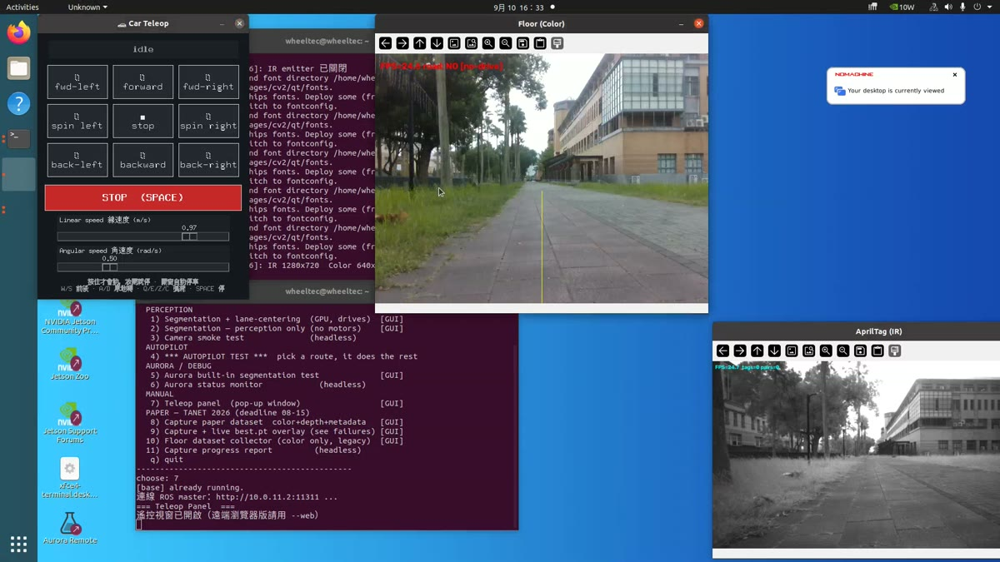
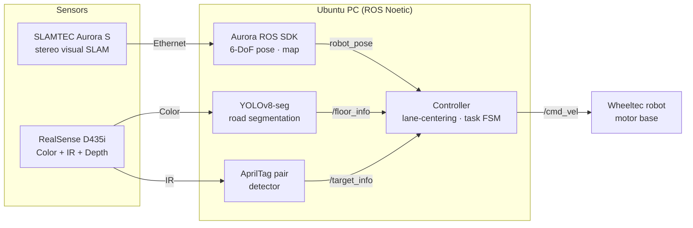
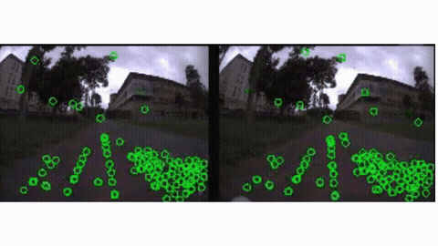
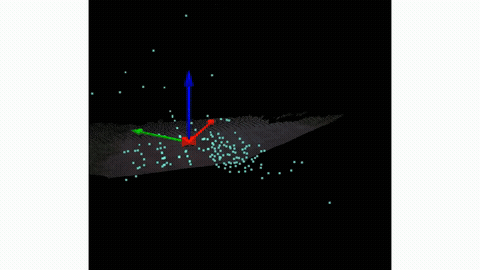
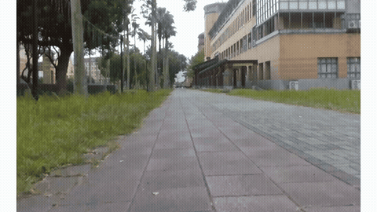
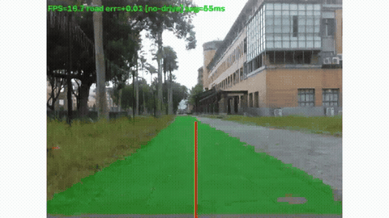

# Go by Myself — Visual-SLAM Autonomous Driving Car

An outdoor autonomous ground robot that drives a campus route using **visual SLAM** as its
primary localization, with **road segmentation** to keep it on track where SLAM gets weak.
All perception and control run on an off-board Ubuntu PC over ROS Noetic; the robot only
drives.

> Click any preview to open the full-quality video.

---

## System Architecture

<p align="center">
  <a href="docs/media/system_demo.mp4"></a>
  <br><sub>Operator desktop during a field run: teleop panel, color road segmentation, IR AprilTag view and task launcher.</sub>
</p>



| Device | Role | Link |
|---|---|---|
| Wheeltec robot (ROS master) | Motor base, receives `/cmd_vel` | `10.0.11.2` over 5 GHz Wi-Fi |
| Ubuntu PC | Perception, SLAM client, control | `10.0.11.3` |
| SLAMTEC Aurora S | On-device visual SLAM, mounted front-centre, 0.45 m high | Ethernet `192.168.11.1` |
| Intel RealSense D435i | Color (segmentation) + IR (AprilTag, global shutter) | USB 3 |

---

## Visual SLAM

The Aurora S tracks stereo features and builds a map of the route on the device. It runs as its
own TF tree (`aurora_map → aurora_odom → aurora_base_link`) so it doesn't clash with the
robot's `map → odom → base_link`.

| Feature extraction | Mapping |
|:---:|:---:|
| [](docs/media/vslam_features.mp4) | [](docs/media/vslam_mapping.mp4) |
| Stereo keypoints tracked on both cameras | Point-cloud map and keyframe trajectory built while driving |

Tools in [`Detect/new_detect/aurora/`](Detect/new_detect/aurora/): launch wrapper, headless
status display, map save/load/relocalize, rosbag recording and offline SLAM-quality analysis.

---

## Segmentation

One part of the route is an open, straight brick path between grass, trees and buildings.
It has few nearby, stable features, so visual SLAM drifts there. A YOLOv8-seg model finds the
road in the color stream, and the controller steers to keep the robot centred on it. This
corrects sideways drift and heading even when the SLAM pose is unreliable.

| Without segmentation | With segmentation |
|:---:|:---:|
| [](docs/media/no_seg.mp4) | [](docs/media/seg.mp4) |
| Raw color frame on the brick path | Segmented road (green), with the road centre and image centre lines used for steering |

Classes: `grass`, `road`, `sidewalk`. Inference ≈ 90–190 ms per frame on CPU at 320 px, in a
worker thread so the 30 fps AprilTag loop never blocks. Dataset and labeling tools (SegFormer
auto-labeling, Gemini image-quality filtering) are in
[`Detect/new_detect/segmentation/`](Detect/new_detect/segmentation/).

---

## Quick Start

```bash
# PC environment
source /opt/ros/noetic/setup.bash
export ROS_MASTER_URI=http://10.0.11.2:11311
export ROS_IP=10.0.11.3
pip3 install -r requirements.txt

# Robot (ssh wheeltec@10.0.11.2)
roslaunch turn_on_wheeltec_robot mapping.launch

# Visual SLAM (build https://github.com/Slamtec/aurora_ros into ~/aurora_ros first)
source ~/aurora_ros/devel/setup.bash
roslaunch Detect/new_detect/aurora/aurora_slam.launch

# Road segmentation + lane-centering (press SPACE in the window to start/pause driving)
python3 Detect/new_detect/ros_detect_dual.py
```

The D435i can be opened by only one program at a time, and the Aurora by only one client at a
time. [`robot_menu.sh`](robot_menu.sh) is a single menu that launches every field test.

## Repository Layout

```
calibration/              Camera calibration (legacy USB-cam pipeline only)
Detect/apriltag_setting/  AprilTag pair detection core
Detect/old_detect/        Legacy: camera on the robot
Detect/new_detect/        Current: D435i perception, controllers, route map
  ├── aurora/             Aurora S visual SLAM tools
  ├── segmentation/       Road segmentation & dataset tools
  ├── models/             Trained YOLOv8-seg weights
  └── route/              Segmented A/B/C/D route definitions
robot_menu.sh             Field-test launcher menu
docs/media/               README images and videos
paper/                    TANet paper plan (edge VLM for SLAM-degradation detection)
```
